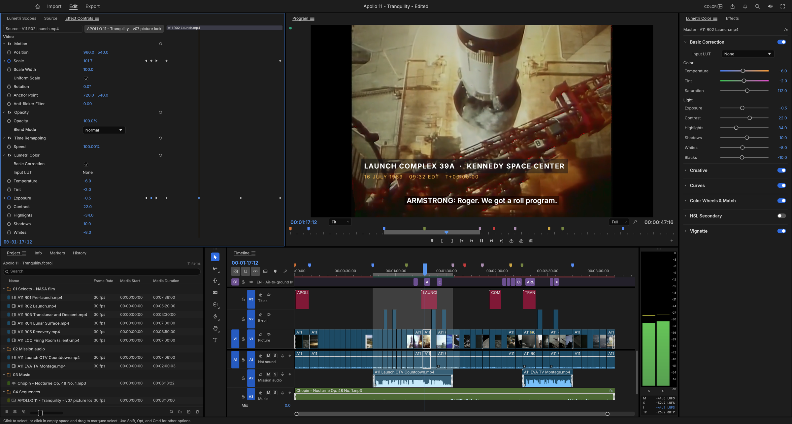

# FilmCraft v0.6.0 RC19 — 한국어 커뮤니티 패치

  

  <strong>Rust 기반 오픈소스 비선형 영상 편집기 · 한국어 UI · 한글 문자/자막 · YouTube Shorts 내보내기</strong>

  <a href="https://github.com/storytold/filmcraft">FilmCraft 원본 프로젝트</a> ·
  <a href="https://discord.gg/artcraft">ArtCraft Discord</a> ·
  <a href="https://ctee.kr/place/caw">한국어 패치 후원</a>

> [!IMPORTANT]
> **현재 버전: FilmCraft 한국어 패치 v0.6.0 RC19 (Release Candidate)**  
> 이 저장소는 FilmCraft 원본의 **비공식 한국어 커뮤니티 패치**를 위한 소스입니다. `v0.6.0 RC19`는 한국어 패치 릴리스 표기이며, 원본 워크스페이스의 Cargo 버전(`0.5.0`)과 별개입니다. 원본 ArtCraft 팀의 공식 한국어 릴리스가 아닙니다.
>
> **Windows 실제 컴파일·GUI 실행, 한글 IME 실입력, NVENC 인코딩, Shorts MP4 출력, 설치·업데이트·제거의 최종 검증은 아직 확인되지 않았습니다.** 따라서 정식 안정판으로 표기하지 않습니다.

## 프로젝트 소개

FilmCraft는 멀티트랙 영상 편집, 소스/프로그램 모니터, 색보정, 전환 효과, 오디오 편집, 텍스트 그래픽, 자막과 결과물 내보내기를 제공하는 오픈소스 NLE(비선형 영상 편집기)입니다. 원본 프로젝트는 Rust 기반으로 macOS, Windows, Linux 및 WebAssembly 환경을 목표로 개발됩니다.

한국어 커뮤니티 패치는 **한국어 UI 및 Windows 사용자 환경**에 초점을 맞추며, 한글 입력과 자막 호환성, 세로형 Shorts 출력, 잘못된 Windows 경로 차단, 사용자에게 보이는 오류 처리, 설치·배포 검증 도구를 보완합니다.

| 프로젝트 정보 | 내용 |
| --- | --- |
| 이름 | FilmCraft |
| 커뮤니티 패치 | **v0.6.0 RC19** |
| 언어/UI | Rust, egui / eframe |
| 원본 Cargo 패키지 버전 | `0.5.0` (패치 버전과 다름) |
| 중점 운영체제 | Windows x64 한국어 환경 |
| 기반 소스 | [storytold/filmcraft](https://github.com/storytold/filmcraft) |
| 라이선스 | `MIT OR Apache-2.0` (원본 고지·제3자 라이선스 준수) |
| 배포 상태 | **개발 중 / Release Candidate / 실기기 수락 검사 미완료** |

## 주요 기능 및 현재 상태

이 표의 **구현**은 RC19 소스에 기능 또는 호출 경로가 존재한다는 뜻입니다. **실기기 검증 필요**는 실제 Windows에서 정상 동작 여부를 별도로 확인해야 한다는 뜻입니다.

| 분야 | 포함된 기능 | RC19 상태 |
| --- | --- | --- |
| 영상 편집 | 멀티트랙 타임라인, 클립 배치·트리밍, 마커, 키프레임, 실행 취소, 프로젝트 관리 | 원본 기반 구현 |
| 미리보기 | 소스/프로그램 모니터, 프레임 탐색, GPU 합성 경로 | 원본 기반 구현 / 장치별 검증 필요 |
| 색보정·영상 효과 | 색온도, 노출, 대비, 커브, 컬러 휠, LUT, 효과·전환 | 원본 기반 구현 |
| 오디오 | 트랙 믹싱, 게인, 팬, 오디오 효과, 레벨 모니터링 | 원본 기반 구현 |
| 그래픽 문자 도구 | 문자·도형, 글꼴/스타일, 텍스트 편집, Windows 한글 IME 대응 | 구현 / **실제 한글 입력 검증 필요** |
| 자막 | SRT·WebVTT, 한글 글꼴, CP949 SRT 읽기, 긴 자막 줄바꿈 | 한국어판 개선 코드 포함 |
| 한국어 UI | 언어 선택·설정 유지, 한국어 번역 | **3,783개 한국어 항목**, 기준 키 100% 대응 |
| 빠른 내보내기 | 사용자 프리셋, H.264 MP4, CPU/GPU 인코딩 선택 | 구현 / 실제 출력 검증 필요 |
| YouTube Shorts | 1080×1920 (9:16) 세로형 프리셋 | 구현 / 실제 MP4 검증 필요 |
| 출력 경로 보호 | 파일명·상위 폴더 검증, 한글·UNC 경로, 프리셋 확장자 처리 | **RC19 강화**, 정적 테스트 통과 |
| 외부 링크 | 후원·Discord 버튼, 기본 브라우저 호출·실패 시 URL 복사 | 코드 구현 / 실제 클릭 검증 필요 |
| Windows 패키징 | 설치형·포터블 제작 설정, 체크섬 검사, 수락 리포트 | 스크립트 존재 / 설치 동작 미검증 |

> [!NOTE]
> 번역 키의 **100% 대응**은 번역표와 참조 키의 기계적 대응률입니다. 모든 문구의 자연스러움, 글꼴 품질, 창 크기별 표시 상태가 100% 검증되었다는 뜻은 아닙니다.

## RC19에서 새롭게 개선된 기능

### 1. Windows 내보내기 경로 전체 검증

이전에는 출력 파일 이름 검증에 초점이 맞춰져 있었지만, RC19에서는 **파일명뿐 아니라 경로의 상위 폴더 구성 요소까지 검사**합니다. 빠른 내보내기, 일반 내보내기 및 내보내기 대기열로 전달되는 경로에 적용됩니다.

- 빈 파일명, 경로 끝 구분자, 잘못된 문자 및 제어문자 거부
- `CON`, `PRN`, `AUX`, `NUL`, `COM1`~`COM9`, `LPT1`~`LPT9` 등 Windows 예약 장치명 차단
- 확장자가 붙은 장치명과 일부 위 첨자 숫자(예: `COM¹.mp4`)도 차단
- `\\?\` 등 장치 네임스페이스와 잘못된 드라이브 상대경로 차단
- 정상적인 **한글 파일·폴더 이름**, 로컬 절대/상대 경로, UNC 공유 경로 허용
- 잘못된 경로 입력 시 내보내기를 시작하지 않고 한국어 상태 안내 제공

| 입력 예시 | 예상 처리 |
| --- | --- |
| `C:\영상\가을 여행.mp4` | 허용 |
| `\\server\share\가을.mp4` | 허용 |
| `영상/한국어 123 ABC.mp4` | 허용 |
| `C:\NUL\영상.mp4` | 거부 |
| `C:\bad?folder\영상.mp4` | 거부 |
| `COM¹.mp4` | 거부 |
| `C:relative.mp4` | 거부 |

**제한:** 경로 문자열이 유효해도 실제 폴더가 없거나 쓰기 권한이 없으면 출력은 실패할 수 있습니다. 이 검증은 파일 생성의 성공을 보장하지 않습니다.

### 2. 프리셋 전환 시 파일 확장자 안정화

- Windows 역슬래시(`\`)와 슬래시(`/`)를 모두 경로 구분자로 처리
- 부모 폴더의 점(`.`)을 파일 확장자로 잘못 판단하지 않음
- `C:\folder.v2\여행.mov`에서 프리셋을 MP4로 전환하면 `C:\folder.v2\여행.mp4`로 처리
- 한글 파일명과 상위 폴더 경로 보존

### 3. Windows 수락 검사 보고서 추가

`scripts/rc19-windows-acceptance.ps1`은 개발자가 Windows 환경에서 빌드·테스트·패키지 관련 점검 결과를 기록할 수 있도록 추가된 스크립트입니다. 보고서 경로는 `build-logs/rc19-acceptance.json`입니다.

자동 확인 정보에는 Windows x64 환경, Rust·Python·설치 제작 도구·ffprobe의 존재, 요청된 작업의 종료 코드, 설치/포터블 산출물과 GUI 실행 파일의 존재 여부가 포함됩니다.

**한글 실제 입력, 브라우저 버튼 클릭, MP4 디코딩, NVENC 실동작, 설치·제거 등은 자동 성공 처리하지 않고 `NOT_TESTED`로 기록**합니다.

## 기존 RC 버전에서 유지된 한국어판 기능

### 한국어 문자 도구 및 IME

- Windows IME 조합(Preedit), 확정(Commit), 주변 문자 삭제 이벤트 처리 코드
- 확정 문자열이 일반 텍스트 이벤트로 중복 전달되는 상황 완화
- 반복되는 동일 한글 입력과 중복 에코 텍스트 구분
- 새 텍스트 레이어 및 재편집 시 키보드 포커스 요청 조정
- 조합 도중 Enter·Escape·Backspace 등의 키 처리 개선
- 이벤트 유형·길이·포커스 상태 중심의 선택적 진단(입력 원문은 기록하지 않도록 설계)
- RC17의 `has_ime_edit()` 미사용 함수 경고에 대한 **`#[cfg(test)]` 처리 유지**

**중요:** 한글 입력 처리 코드는 존재하지만 Microsoft IME에서 `안녕하세요`, `한글 ABC 123`, `한한` 입력을 실제로 성공했다고 확인한 상태는 아닙니다.

### 한글 자막 및 그래픽

- UTF-8 및 구형 **CP949** SRT 입력 처리
- SRT·WebVTT 자막 기능과 글꼴·스타일 설정
- 자막에 지정한 글꼴을 줄바꿈 계산과 렌더링에 반영하도록 보완
- 긴 한글 자막의 외곽선·배경 여백을 고려한 줄바꿈
- 자막 버퍼가 과도하게 커지지 않도록 프레임 범위 제한

### YouTube Shorts 빠른 내보내기

| 설정 | 기본값 |
| --- | --- |
| 프리셋 | **YouTube Shorts 1080×1920 (9:16)** |
| 해상도 | **1080 × 1920** |
| 출력 | MP4 / H.264 |
| 목표·최대 비트레이트 | 12 Mbps / 16 Mbps |
| 오디오 | AAC, 48 kHz, 스테레오 |
| 프레임 속도 | 시퀀스 설정 기반 |
| 화면 맞춤 | Scale to Fill (가로 영상의 좌우 크롭 가능) |

프리셋과 설정 해석은 코드 및 테스트에서 확인되었지만, 실제 내보낸 MP4가 정상 재생되고 플랫폼에 맞는지 별도 확인해야 합니다.

### 후원·Discord 연결

- 헤더의 후원·Discord 접근 기능
- 좁은 창에서 클릭 영역과 창 드래그 영역의 충돌 방지
- 운영체제 기본 브라우저에 HTTPS URL 열기 요청
- 브라우저 호출 실패 시 상태 안내 및 URL 클립보드 복사 경로
- 후원: [한국어 커뮤니티 패치 후원](https://ctee.kr/place/caw)
- Discord: [ArtCraft 커뮤니티](https://discord.gg/artcraft)

실제 브라우저 탭 열림 여부는 Windows에서 수동 확인이 필요합니다. **한국어 패치 후원은 원본 ArtCraft의 공식 후원과 별개이며 선택 사항**입니다.

## GPU 인코딩 구현 범위

**GPU 영상 합성, GPU 장치 탐색, 외부 FFmpeg 시험 인코딩, FilmCraft 자체 하드웨어 인코딩은 서로 다른 기능입니다.**

| 인코딩 방식 | RC19 코드 상태 | 검증 및 제한 |
| --- | --- | --- |
| CPU H.264 | 소프트웨어 출력 경로 존재 | 실제 RC19 MP4 출력 검증 필요 |
| NVIDIA NVENC | Windows NVENC 인코딩 경로 존재 | 지원 GPU·드라이버에서 실측 필요 |
| macOS VideoToolbox | 원본 플랫폼 인코딩 경로 존재 | macOS 실기기 검증 필요 |
| AMD AMF | **FilmCraft 내부 H.264 인코더 미구현** | 외부 FFmpeg 시험과 별개 |
| Intel Quick Sync Video (QSV) | **FilmCraft 내부 H.264 인코더 미구현** | 장치 후보 조회와 별개 |
| Windows Media Foundation 탐색 | 인코더 후보 이름 조회 코드 존재 | 실제 AMF/QSV 출력 지원을 의미하지 않음 |
| 외부 FFmpeg GPU 진단 | NVIDIA/AMD/Intel 시험 도구 존재 | FilmCraft 엔진 기능과 별개 |

지원 가능한 환경에서 GPU 인코딩을 시도하고 실패 시 CPU 출력으로 전환하는 경로가 있지만, **RC19에서 모든 GPU의 정상 출력·자동 복구가 검증되었다고 표시하지 않습니다.**

## 개발 단계별 진행 상황

| 분류 | 항목 |
| --- | --- |
| **코드 구현 확인** | 한국어 번역표, 한글 IME 처리, CP949 SRT, Shorts 프리셋, 전체 Windows 출력 경로 검사, 예약 장치명 차단, RC19 수락 리포트 |
| **부분 완성·검증 필요** | 실제 한글 문자 입력, 자막 렌더링 일치, NVENC·CPU MP4 출력, 설치형/포터블 배포, 링크 클릭, Windows 안정성 |
| **미구현** | FilmCraft 자체 AMD AMF H.264 인코더, FilmCraft 자체 Intel QSV H.264 인코더 |
| **장기 개선 과제** | GPU 최적화 확대, 실제 미디어 코퍼스, 크로스플랫폼 런타임 검증, 사용자 워크플로 자동화 테스트 |

## 정적 점검 현황

RC19 전체 소스 ZIP의 Python 검사 코드를 기준으로, 아래 결과를 별도로 확인했습니다.

| 검사 | 확인 결과 |
| --- | --- |
| `check_rc19_features.py` | **4개 정적 테스트 통과** |
| `check_rc18_export.py` | **5개 정적 테스트 통과** |
| `check_rc17_ime_dead_code.py` | `has_ime_edit` 테스트 전용 처리 검사 통과 |
| `check_rc15_links.py` 및 `check_rc16_ui.py` | 기존 버튼·링크 회귀 검사 통과 |
| `check_i18n.py` | 한국어 **3,783개 항목**, 기준 3,514개 키 중 3,514개 대응, 누락 0개 |
| Windows GUI / GPU / 실제 설치·출력 | **미수행** |

이 결과는 **소스 구조 및 번역 파일 정적 검사**입니다. Rust 실제 컴파일 통과, Windows 실행이나 사용성 인증을 의미하지 않습니다.

## 정식 안정판 전에 필요한 수락 조건

- [ ] Windows x64에서 앱 실행 및 주요 화면·메뉴 정상 표시
- [ ] 문자 도구: `안녕하세요`, `한글 ABC 123`, `한한`, Backspace·Enter·방향키 정상
- [ ] SRT/WebVTT 자막 가져오기 → 편집 → 저장 → 다시 열기
- [ ] 한글 폰트·자막 외곽선·배경이 미리보기와 실제 영상에서 일치
- [ ] Shorts 1080×1920 H.264/AAC MP4 출력·재생·프레임 및 오디오 검사
- [ ] Windows 금지 경로는 거부, 정상 한글·UNC 경로는 적절히 처리
- [ ] 후원/Discord 클릭 시 기본 브라우저 실제 열림 확인
- [ ] NVIDIA 지원 GPU에서 NVENC 출력 성공, 불가 환경에서 CPU 대체 출력 확인
- [ ] Windows 설치·업데이트·제거 시 프로젝트 및 설정 유지
- [ ] 장시간 사용 시 메모리 누수·충돌·자동 복구 상태 확인

실제 검사 절차와 기록 항목: [`RC19_TEST_GUIDE_KO.md`](RC19_TEST_GUIDE_KO.md).

## 향후 개발 로드맵

> 아래 버전 구간과 기능은 **개발 목표**입니다. 확정된 출시 일정이나 구현 완료 선언이 아닙니다.

### RC20 이후 — Windows 한국어 UI 안정화

- [ ] 한글 IME 문자 도구의 첫 글자·조합·삭제·재편집 문제를 실제 Windows에서 검증 및 수정
- [ ] 한글 폰트 폴백, 텍스트 커서/선택, 줄바꿈과 다양한 배율 안정화
- [ ] 설치형/포터블 배포와 업그레이드·제거 검증
- [ ] 자막 입력·영상 출력 전체 워크플로 회귀 테스트
- [ ] 외부 링크 버튼과 오류 안내의 Windows 수동 검증

### GPU 인코딩 확장

- [ ] **AMD AMF H.264 자체 인코딩 경로 구현 및 UI 연동**
- [ ] **Intel QSV H.264 자체 인코딩 경로 구현 및 UI 연동**
- [ ] 지원 GPU·드라이버·코덱의 정확한 자동 판별
- [ ] NVENC/AMF/QSV 실패 원인 표시 및 CPU 안전 대체 경로 검증
- [ ] GPU별 H.264·HEVC 실제 출력 품질·속도·호환성 비교
- [ ] GPU 합성·디코딩·인코딩 간 메모리 복사 비용 최적화

### 영상 편집·자막·Shorts 고도화

- [ ] 긴 영상·고해상도 프로젝트의 미리보기 캐시·프록시 최적화
- [ ] 플랫폼별 세로 영상 안전 영역과 화면비 변환 기능 개선
- [ ] 다국어 자막 스타일 템플릿·일괄 편집 확대
- [ ] 로컬 음성 인식 기반 자동 자막 기능 검토
- [ ] 실사 촬영·스마트폰·화면 녹화 파일의 가져오기/편집/출력 회귀 코퍼스 확보

### v0.6.0 Stable — 정식 안정판 목표

- [ ] RC19 이후 핵심 기능의 Windows 실기기 수락 검사 통과
- [ ] 실제 MP4 영상·음성·한글 자막 출력 검증 완료
- [ ] 설치·업데이트·제거·프로젝트 데이터 보존 검증 완료
- [ ] 오류·충돌 기록과 장시간 안정성 검사 완료
- [ ] 릴리스 문서 및 사용자 안내 정리 후 정식 배포 여부 결정

## 소스 구성

| 경로 | 역할 |
| --- | --- |
| `crates/ui-egui/` | 데스크톱 UI, 한국어 번역, 문자 도구, 내보내기 화면 |
| `crates/ui-egui/src/panels/export_mode.rs` | RC19 Windows 출력 경로 검증 및 프리셋 확장자 처리 |
| `crates/ui-egui/src/panels/graphics.rs` | 그래픽 문자 도구 및 IME 이벤트 처리 |
| `crates/ui-egui/src/links.rs` | 후원·Discord 외부 링크 처리 |
| `crates/engine/` | 편집 명령, 세션 및 내보내기 설정 연결 |
| `crates/export/` | 내보내기 설정과 Shorts 프리셋 |
| `crates/platform/` | 플랫폼 기능과 NVENC 경로 |
| `crates/captions/`, `crates/text/` | 자막과 텍스트 처리 |
| `scripts/check_rc19_features.py` | RC19 정적 회귀 검사 |
| `scripts/rc19-windows-acceptance.ps1` | Windows 수락 검사 JSON 리포트 |
| `RC19_TEST_GUIDE_KO.md` | RC19 수동 검증 항목 및 한계 |
| `README-KOREAN.md` | 기존 한국어 패치 변경 내역 |

## Windows 배포 상태

RC19 소스에는 Inno Setup 기반 설치 패키징 설정과 포터블 압축 파일 제작 스크립트가 포함되어 있습니다. 계획된 배포 파일명은 아래와 같습니다.

- `FilmCraft_v0.6.0_RC19_Korean_Windows_x64_Setup.exe`
- `FilmCraft_v0.6.0_RC19_Korean_Windows_x64_Portable.zip`

각 산출물의 SHA-256 및 파일 구성 검사 코드도 포함되어 있습니다. **현재 분석한 소스 ZIP에는 완성된 설치 EXE/포터블 ZIP이 들어 있지 않으며**, 위 파일명은 제작 스크립트에 설정된 예상 산출물명입니다. 실행 또는 설치 성공을 의미하지 않습니다.

## 관련 문서 및 커뮤니티

- [RC19 테스트·수락 기준](RC19_TEST_GUIDE_KO.md)
- [RC18 테스트 안내](RC18_TEST_GUIDE_KO.md)
- [RC16 릴리스 노트](RELEASE_NOTES_KO_v0.6.0_RC16.md)
- [RC17 릴리스 노트](RELEASE_NOTES_KO_v0.6.0_RC17.md)
- [한국어 패치 변경 이력](README-KOREAN.md)
- [FilmCraft 원본 로드맵](ROADMAP.md)
- [원본 저장소](https://github.com/storytold/filmcraft)
- [ArtCraft Discord](https://discord.gg/artcraft)
- [한국어 커뮤니티 패치 후원](https://ctee.kr/place/caw)

## 라이선스와 출처

원본 FilmCraft는 **MIT OR Apache-2.0** 듀얼 라이선스를 사용합니다. [`LICENSE-MIT`](LICENSE-MIT), [`LICENSE-APACHE`](LICENSE-APACHE), [`NOTICE`](NOTICE), [`ATTRIBUTION.md`](ATTRIBUTION.md)를 유지하고, 제3자 자료의 이용 조건을 확인해 주세요.

- **원본 FilmCraft:** ArtCraft 팀 및 오픈소스 기여자
- **RC19:** 비공식 한국어 커뮤니티 패치
- **공식 여부:** ArtCraft 팀의 공식 한국어 릴리스가 아닙니다.

---

**문서 기준:** `FilmCraft_v0.6.0_RC19_Korean_PartialCompletion_Full_Source.zip`의 소스 코드와 `README-KOREAN.md`, `RC19_TEST_GUIDE_KO.md`, 정적 회귀 테스트. 본 문서는 **컴파일 방법을 포함하지 않으며**, 확인하지 않은 Windows 실기기 결과를 완료로 표기하지 않습니다.
